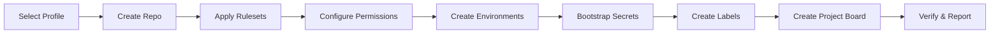
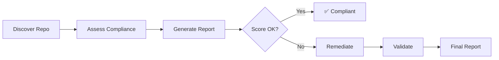

# Governance Engine

The Golden Repository Governance Engine automates the creation, assessment, and remediation of repositories against enterprise governance standards. It is designed to be operated by **GitHub Copilot / AI Agents** via MCP, **VS Code Chat Participant**, **GitHub Actions workflows**, or **CLI scripts**.


## Architecture

```
governance/
├── profiles/                    # YAML governance profiles (archetypes)
│   ├── azure-ai-landing-zone.yml
│   ├── cloud-native-app.yml
│   ├── data-platform.yml
│   ├── aks-platform.yml
│   └── fabric-project.yml
├── engine/                      # Core engine scripts
│   ├── create-repo.sh          # Creates and governs a new repository
│   ├── assess-repo.sh          # Assesses compliance against a profile
│   ├── remediate-repo.sh       # Fixes governance gaps
│   ├── azure-integrate.sh      # Azure OIDC, RBAC, Key Vault setup
│   ├── audit-log.sh            # Audit & evidence store functions
│   └── format-report.sh        # Formats compliance reports
├── mcp-server/                  # MCP Server for Copilot / AI Agent
│   ├── src/index.js            # MCP tool definitions and handlers
│   ├── package.json
│   └── README.md
├── copilot-participant/         # VS Code Chat Participant (@governance)
│   ├── src/extension.ts        # Chat participant handler
│   ├── package.json            # VS Code extension manifest
│   ├── tsconfig.json
│   └── README.md
└── README.md                    # This file
```

## Process Flows

### A. New Repository (from Template)



**Workflow:** `.github/workflows/governance-create.yml`

### B. Existing Repository (Assess & Remediate)



**Workflows:**

- `.github/workflows/governance-assess.yml`
- `.github/workflows/governance-remediate.yml`

## Governance Profiles

| Profile                 | Description                | Key Features                                                 |
| ----------------------- | -------------------------- | ------------------------------------------------------------ |
| `azure-ai-landing-zone` | Full Azure AI project      | OIDC, RBAC, Key Vault, 4 environments, signed commits        |
| `cloud-native-app`      | Containerized microservice | Docker, K8s, 3 environments, lighter security                |
| `data-platform`         | Data engineering           | Strict compliance, signed commits, wiki, data classification |
| `aks-platform`          | AKS platform engineering   | GitOps, Flux, 4 environments (incl. DR), container scanning  |
| `fabric-project`        | Microsoft Fabric analytics | Workspace sync, data governance, wiki, signed commits        |

### Profile Structure

Each YAML profile defines:

```yaml
repository: # Visibility, merge settings, topics
rulesets: # Branch protection rules
required_files: # Files that must exist
workflows: # Required CI/CD workflows
environments: # Deployment environments with gates
security: # CodeQL, secret scanning, Dependabot
azure: # OIDC, RBAC, Key Vault
labels: # Issue/PR labels
teams: # Team permissions
project: # Project board configuration
webhooks: # Webhook endpoints and events
milestones: # Default milestones for new repos
```

## Usage

### 1. Create a New Repository (UI)

1. Go to **Actions** → **Governance: Create Repository**
2. Select a governance profile
3. Enter the repository name, team slug, and project name
4. Click **Run workflow**

### 2. Create a New Repository (CLI)

```bash
gh workflow run governance-create.yml \
  -f profile=azure-ai-landing-zone \
  -f repo_name=my-new-service \
  -f team_slug=backend-team \
  -f project_name="My New Service"
```

### 3. Assess an Existing Repository

```bash
# Assess this repository
gh workflow run governance-assess.yml \
  -f profile=azure-ai-landing-zone

# Assess another repository
gh workflow run governance-assess.yml \
  -f profile=cloud-native-app \
  -f target_repo=my-org/existing-repo
```

### 4. Remediate Governance Gaps

```bash
# Preview changes (safe mode)
gh workflow run governance-remediate.yml \
  -f profile=azure-ai-landing-zone \
  -f mode=safe

# Apply changes after review
gh workflow run governance-remediate.yml \
  -f profile=azure-ai-landing-zone \
  -f mode=semi-auto
```

### 5. Run Engine Scripts Locally

```bash
# Create a repo
./governance/engine/create-repo.sh azure-ai-landing-zone my-org my-repo backend-team "My Project"

# Assess a repo
./governance/engine/assess-repo.sh azure-ai-landing-zone my-org/my-repo

# Remediate (dry-run)
./governance/engine/remediate-repo.sh azure-ai-landing-zone my-org/my-repo safe
```

## Remediation Modes

| Mode        | Behavior                               | Use Case                           |
| ----------- | -------------------------------------- | ---------------------------------- |
| `safe`      | Preview only — no changes applied      | Review before applying             |
| `semi-auto` | Apply API changes, PR for file changes | Balanced approach                  |
| `auto`      | Apply everything directly              | CI/automation, scheduled drift fix |

## Scheduled Drift Detection

The assessment workflow runs weekly (Monday 06:00 UTC) to detect configuration drift. If the compliance score drops below the threshold:

1. A GitHub Issue is automatically created
2. The workflow summary shows detailed findings
3. Run the remediation workflow to restore compliance

## Requirements

### Secrets

| Secret           | Purpose                                               | Required For               |
| ---------------- | ----------------------------------------------------- | -------------------------- |
| `GOVERNANCE_PAT` | Personal Access Token with `repo`, `admin:org` scopes | Create/Remediate workflows |

### Tools (for local execution)

- `gh` CLI (authenticated)
- `yq` (YAML parser)
- `jq` (JSON processor)

## Adding a New Profile

1. Copy an existing profile from `governance/profiles/`
2. Modify the settings for your archetype
3. Add the profile name to the workflow `choice` options in:
   - `governance-create.yml`
   - `governance-assess.yml`
   - `governance-remediate.yml`
4. Test with: `./governance/engine/assess-repo.sh your-profile org/test-repo`

## Policy & Guardrails

The engine follows these principles:

- **Idempotent**: Running the same operation twice produces the same result
- **Safe Execution**: Default mode previews changes before applying
- **Least Privilege**: Uses minimum required permissions
- **Approval Gates**: Semi-auto mode for sensitive changes
- **Audit Logging**: All changes recorded via audit-log.sh and workflow artifacts
- **Rollback Support**: Rulesets and settings can be reverted

## Azure Integration Layer

The `azure-integrate.sh` script provisions Azure resources for governed repositories:

```bash
# Set up Azure OIDC + RBAC for a repository
./governance/engine/azure-integrate.sh azure-ai-landing-zone my-org/my-repo <subscription-id> <resource-group>
```

| Component                  | Action                                                             |
| -------------------------- | ------------------------------------------------------------------ |
| Entra ID App Registration  | Creates app + service principal                                    |
| OIDC Federated Credentials | Configures GitHub → Azure trust per profile                        |
| RBAC Role Assignments      | Assigns roles defined in profile                                   |
| Key Vault                  | Creates vault with RBAC authorization (if enabled)                 |
| Resource Group             | Auto-creates with governance tags (if not provided)                |
| GitHub Variables           | Sets `AZURE_CLIENT_ID`, `AZURE_TENANT_ID`, `AZURE_SUBSCRIPTION_ID` |

## Audit & Evidence Store

All governance operations produce audit trails:

| Artifact           | Location                   | Purpose                                            |
| ------------------ | -------------------------- | -------------------------------------------------- |
| Audit trail        | `audit-trail.jsonl`        | Every action logged with timestamp, actor, details |
| Compliance history | `compliance-history.jsonl` | Score over time per repository                     |
| Change history     | `change-history.jsonl`     | Every setting change with old/new values           |
| Exceptions         | `exceptions.jsonl`         | Documented exceptions with expiry dates            |
| Evidence           | `evidence/` directory      | Compliance report snapshots                        |

Source the module in your scripts:

```bash
source ./governance/engine/audit-log.sh
audit_log "category" "action" "target" "details"
record_compliance "org/repo" "profile" 95
record_change "org/repo" "repository" "visibility" "public" "private"
```

## MCP Server (Copilot / AI Agent)

The MCP server enables AI agents to operate the governance engine through natural language.

```bash
# Install and start
cd governance/mcp-server
npm install
npm start
```

See [mcp-server/README.md](mcp-server/README.md) for VS Code integration and available tools.

## Copilot Chat Participant (`@governance`)

The Chat Participant provides a conversational interface directly in VS Code Copilot Chat.

### Available Commands

| Command | Description |
|---------|-------------|
| `/create` | Create a new governed repository from a profile |
| `/assess` | Assess compliance of an existing repository |
| `/remediate` | Fix governance gaps (safe/semi-auto/auto modes) |
| `/profiles` | List available governance profiles |
| `/report` | Generate a compliance report (markdown/JSON/badge) |
| `/azure` | Set up Azure OIDC, RBAC, and Key Vault |

### Example Usage

```
@governance /profiles
@governance /create azure-ai-landing-zone my-service backend-team "My Service"
@governance /assess cloud-native-app my-org/existing-repo
@governance /remediate data-platform my-org/my-repo semi-auto
@governance /azure azure-ai-landing-zone my-org/my-repo <subscription-id>
```

### Setup

```bash
cd governance/copilot-participant
npm install
npm run build
```

Then press **F5** in VS Code to launch with the extension loaded.

See [copilot-participant/README.md](copilot-participant/README.md) for full details.

## Capability Matrix

| Capability                        | Org Level (Admin) | Repo Level (Admin) | Automation (Agent) | Notes                          |
| --------------------------------- | ----------------- | ------------------ | ------------------ | ------------------------------ |
| Org Rulesets                      | ✅                | ❌                 | ⚠️ (if allowed)    | Requires org admin             |
| Repo Rulesets / Branch Protection | ❌                | ✅                 | ✅                 | Can be automated via API / CLI |
| Environments                      | ❌                | ✅                 | ✅                 | Approvals per env              |
| Secrets / Variables               | ❌                | ✅                 | ✅                 | Repo or Org level              |
| Teams & Permissions               | ✅                | ❌                 | ✅                 | Depends on rights              |
| Workflows / Files                 | ❌                | ✅                 | ✅                 | Via PR or direct               |
| Security Scanning                 | ✅                | ✅                 | ✅                 | If enabled by org              |
| Projects / Labels / Milestones    | ❌                | ✅                 | ✅                 | Repo level                     |
| Azure OIDC / App Reg              | ❌                | ❌                 | ✅                 | Requires Azure access          |

## Integration & Automation Options

| Method                       | Best For                                     | Trigger Types                     |
| ---------------------------- | -------------------------------------------- | --------------------------------- |
| GitHub Actions Workflow      | Standard CI/CD, scheduled drift detection    | Manual, schedule, webhook         |
| MCP Server (Copilot Agent)   | Conversational governance, ad-hoc operations | User/AI prompt                    |
| Chat Participant (@governance) | VS Code interactive governance             | User prompt in Copilot Chat       |
| CLI Scripts                  | Local development, automation pipelines      | Manual, scripts                   |
| GitHub App                   | Scale across many orgs (future)              | Repository created, policy change |

### Event Triggers

- **Manual** — User or Copilot command
- **Repository Created** — Webhook triggers governance bootstrap
- **Schedule** — Weekly drift detection (Monday 06:00 UTC)
- **Pull Request Merged** — Validate post-merge compliance
- **Policy Change Detected** — Re-assess affected repositories
