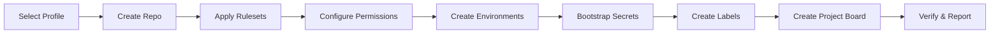
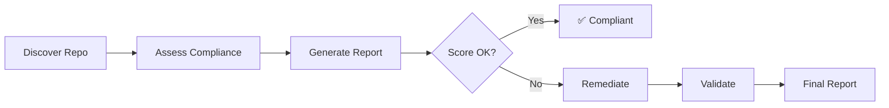

# Governance Engine

The Golden Repository Governance Engine automates the creation, assessment, and remediation of repositories against enterprise governance standards.

## Architecture

```
governance/
├── profiles/                    # YAML governance profiles (archetypes)
│   ├── azure-ai-landing-zone.yml
│   ├── cloud-native-app.yml
│   └── data-platform.yml
├── engine/                      # Core engine scripts
│   ├── create-repo.sh          # Creates and governs a new repository
│   ├── assess-repo.sh          # Assesses compliance against a profile
│   ├── remediate-repo.sh       # Fixes governance gaps
│   └── format-report.sh        # Formats compliance reports
└── README.md                    # This file
```

## Process Flows

### A. New Repository (from Template)



**Workflow:** `.github/workflows/governance-create.yml`

### B. Existing Repository (Assess & Remediate)



**Workflows:**

- `.github/workflows/governance-assess.yml`
- `.github/workflows/governance-remediate.yml`

## Governance Profiles

| Profile                 | Description                | Key Features                                                 |
| ----------------------- | -------------------------- | ------------------------------------------------------------ |
| `azure-ai-landing-zone` | Full Azure AI project      | OIDC, RBAC, Key Vault, 4 environments, signed commits        |
| `cloud-native-app`      | Containerized microservice | Docker, K8s, 3 environments, lighter security                |
| `data-platform`         | Data engineering           | Strict compliance, signed commits, wiki, data classification |

### Profile Structure

Each YAML profile defines:

```yaml
repository: # Visibility, merge settings, topics
rulesets: # Branch protection rules
required_files: # Files that must exist
workflows: # Required CI/CD workflows
environments: # Deployment environments with gates
security: # CodeQL, secret scanning, Dependabot
azure: # OIDC, RBAC, Key Vault
labels: # Issue/PR labels
teams: # Team permissions
project: # Project board configuration
```

## Usage

### 1. Create a New Repository (UI)

1. Go to **Actions** → **Governance: Create Repository**
2. Select a governance profile
3. Enter the repository name, team slug, and project name
4. Click **Run workflow**

### 2. Create a New Repository (CLI)

```bash
gh workflow run governance-create.yml \
  -f profile=azure-ai-landing-zone \
  -f repo_name=my-new-service \
  -f team_slug=backend-team \
  -f project_name="My New Service"
```

### 3. Assess an Existing Repository

```bash
# Assess this repository
gh workflow run governance-assess.yml \
  -f profile=azure-ai-landing-zone

# Assess another repository
gh workflow run governance-assess.yml \
  -f profile=cloud-native-app \
  -f target_repo=my-org/existing-repo
```

### 4. Remediate Governance Gaps

```bash
# Preview changes (safe mode)
gh workflow run governance-remediate.yml \
  -f profile=azure-ai-landing-zone \
  -f mode=safe

# Apply changes after review
gh workflow run governance-remediate.yml \
  -f profile=azure-ai-landing-zone \
  -f mode=semi-auto
```

### 5. Run Engine Scripts Locally

```bash
# Create a repo
./governance/engine/create-repo.sh azure-ai-landing-zone my-org my-repo backend-team "My Project"

# Assess a repo
./governance/engine/assess-repo.sh azure-ai-landing-zone my-org/my-repo

# Remediate (dry-run)
./governance/engine/remediate-repo.sh azure-ai-landing-zone my-org/my-repo safe
```

## Remediation Modes

| Mode        | Behavior                               | Use Case                           |
| ----------- | -------------------------------------- | ---------------------------------- |
| `safe`      | Preview only — no changes applied      | Review before applying             |
| `semi-auto` | Apply API changes, PR for file changes | Balanced approach                  |
| `auto`      | Apply everything directly              | CI/automation, scheduled drift fix |

## Scheduled Drift Detection

The assessment workflow runs weekly (Monday 06:00 UTC) to detect configuration drift. If the compliance score drops below the threshold:

1. A GitHub Issue is automatically created
2. The workflow summary shows detailed findings
3. Run the remediation workflow to restore compliance

## Requirements

### Secrets

| Secret           | Purpose                                               | Required For               |
| ---------------- | ----------------------------------------------------- | -------------------------- |
| `GOVERNANCE_PAT` | Personal Access Token with `repo`, `admin:org` scopes | Create/Remediate workflows |

### Tools (for local execution)

- `gh` CLI (authenticated)
- `yq` (YAML parser)
- `jq` (JSON processor)

## Adding a New Profile

1. Copy an existing profile from `governance/profiles/`
2. Modify the settings for your archetype
3. Add the profile name to the workflow `choice` options in:
   - `governance-create.yml`
   - `governance-assess.yml`
   - `governance-remediate.yml`
4. Test with: `./governance/engine/assess-repo.sh your-profile org/test-repo`

## Policy & Guardrails

The engine follows these principles:

- **Idempotent**: Running the same operation twice produces the same result
- **Safe Execution**: Default mode previews changes before applying
- **Least Privilege**: Uses minimum required permissions
- **Approval Gates**: Semi-auto mode for sensitive changes
- **Audit Logging**: All changes recorded in workflow run logs
- **Rollback Support**: Rulesets and settings can be reverted
